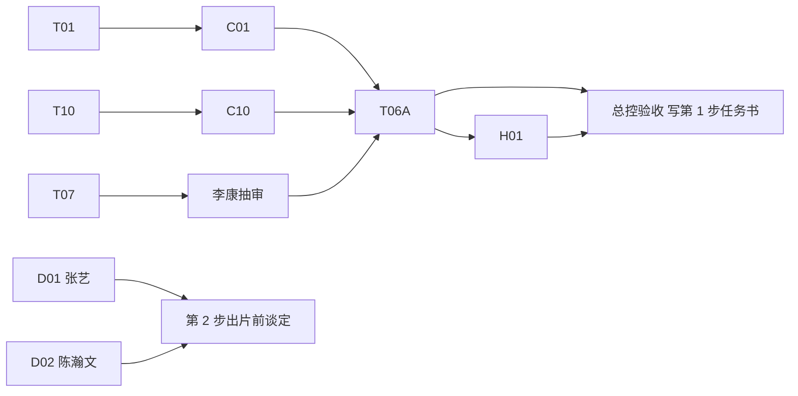

# 派工总表（v0.4，第 0 步）

2026-11-16，总控起草。分工：总控写任务书、验收；李康分派给人或智能体执行。全貌见 `..\总方案_v0.4.md`。

这张表只管第 0 步：不花看图的钱，把现成的东西对齐、汇拢，弄清楚第 1 步的钱该花在哪。第 1 步以后的任务书，等第 0 步的结果出来再写，因为它们的内容取决于这些结果（最后一节有预告）。

## 任务一览

| 任务号 | 做什么 | 为什么 | 谁做 | 要等谁 | 怎么检查 |
|---|---|---|---|---|---|
| T01 | 给范围内 21,152 个视频建一张表，把主库路径、镜序编号、标注库 ID 对上 | 三套系统各认各的编号，不对上，数据接不到同一个文件 | 智能体 | 不用等 | C01，独立检查 |
| T10 | 把镜序里人确认过的记录和陈瀚文标注库的机器标签转成统一格式 | 前者是标准答案，后者用来缩小找素材的范围 | 智能体 | 不用等，可以和 T01 同时做 | C10，独立检查 |
| T07 | 把第一条线 8 套文案的每一句翻成“要什么画面”的查询条件；再翻 78 个素材类别 | 系统拿到的是文案，库里存的是画面标签，中间要有翻译 | 智能体 | 不用等 | 李康抽审，见下面 |
| C01 | 检查 T01 | 原片表错一条，后面全接错 | 另一个智能体，或者人 | T01 | — |
| C10 | 检查 T10 | 标准答案搬丢、搬走样、接错文件，后面的检验就都不可信 | 另一个智能体，或者人 | T10 | — |
| T06A | 核对机器标签哪些字段可信；数出第一条线每类画面有多少素材；给出第 1 步怎么分 2,000 段的额度 | 决定第 1 步的钱花在哪 | 智能体 | T01、T10、T07 第一部分都通过 | 总控验收，李康看缺口说明 |
| H01 | 人工抽查：照 T06A 出的清单看抽帧图，填“对 / 不对 / 看不清”，最多 150 段 | 人确认过的记录太少，有些字段要靠这一轮才能知道可不可信 | 人。熟悉施工画面的同事 | T06A | 不用另查 |
| T12 | Twelve Labs 对比测试：传约 3 小时素材到这家境外的视频理解服务，用中文描述查片段，和现成标签盲评对比（2026-11-17 新增，Eric 已同意外传这一小批） | 第 1 步要定“看图用哪个引擎”，花钱前要有数据 | 智能体；账号和密钥由 Eric 本人办；盲评最多 300 行由人做 | T01、T10、T07 第一部分都通过。可以和 T06A 同时做 | 总控验收；上传前 Eric 过一道关口 |
| D01 | 把对接单发给张艺，谈定 | 镜序要能读入外面给的候选，第 2 步出片才接得上 | 李康 | 不用等 | — |
| D02 | 把对接单发给陈瀚文，谈定 | 片段记录格式、本机模型对比、流程包读入候选 | 李康 | 不用等 | — |

任务书都在这个文件夹里，文件名以任务号开头。H01 没有单独的任务书，说明由 T06A 产出（`人工抽查说明.md`）。

## 先后顺序

T01、T10、T07、D01、D02 五件事现在可以同时开始。

## 检查怎么安排

- **每份任务书自带自查**：“验收标准”一节，执行者做完逐条对照，写进回报。
- **T01、T10 另加独立检查**（C01、C10）。它们是地基，错了后面很难发现，所以做的和查的要分开，检查者用自己写的脚本从原始数据重新算。
- **T07 由你抽审。** 它的对错是业务判断：这句话该不该配这个画面，只有懂业务的人能定。T07 会出一页抽审页，从 8 套文案里挑 2 套，原句、它写的条件、爆款实际配的画面并排列出。你看完说哪几句不对、为什么，T07 的执行者改。条数齐不齐、选项在不在总纲里这类机械的检查，我验收时做。
- **T06A 由我验收。** 它是分析，结论我要用来写下一批任务书。它给你的那页缺口说明请你看一眼。
- 检查结论有三种：通过；小问题，改完不用重查；要返工并重查。后两种由原执行者改。

## 开工口令

把下面的话发给执行的智能体，只换任务书的文件名：

> 请执行这份任务书：`D:\codex-work\codex-company\video-harness-lab\references\素材底座项目-20261116\任务书-v0.4\T01-编号对照.md`
>
> 先按任务书第一行的要求读两份约定，再开工。只做任务书里写的事。每一步的“完成标准”达到了再做下一步。碰到任务书“上报情形”里的情况，或者要删改现有文件、要装软件、要花钱、要输密码，停下来告诉我。做完后在产出文件夹写回报，并告诉我产出文件夹的路径。

各任务对应的文件名：

| 任务号 | 文件名 |
|---|---|
| T01 | `T01-编号对照.md` |
| T10 | `T10-现成数据接入.md` |
| T07 | `T07-观点画面对照表.md` |
| C01 | `C01-检查编号对照.md` |
| C10 | `C10-检查现成数据接入.md` |
| T06A | `T06A-标签可信度与素材够不够表.md` |
| T12 | `T12-TwelveLabs对比测试.md` |

给检查任务的智能体要新开一个对话，不要用做原任务的那个。

## 做完之后

1. 执行者告诉你做完了，产出在 `..\工位产出\<任务号>\` 下。
2. 你安排检查（T01、T10），或者自己抽审（T07）。
3. 你在这个对话里告诉我“某某做完了、查过了”。我读回报和检查报告，给你一个结论：通过，或者要补什么。
4. 第 0 步全部通过后，我写第 1 步的任务书和新的派工总表。

中途执行者写的问题单在 `..\问题反馈\`。规则和口径的问题我来答；要你定的我攒成清单一次问你。

## 你自己要做的

| 事情 | 什么时候要 |
|---|---|
| 发对接单给张艺、陈瀚文（D01、D02） | 现在可以发，第 2 步出片前谈定 |
| 抽审 T07 的抽审页 | T07 第一部分做完后 |
| 定人工审核由谁做（H01，以及第 1 步最多 500 段的审核） | T06A 做完前 |
| 四个口径：水洗石、`美女人设` 禁用、阿明来源规则、用不用扒扒库素材 | 第 1 步开工前。答复前按保守的办 |
| 发几条、在哪些账号发、破万比例到多少算成；人剪的基准数 | 第 3 步发布前 |
| 第 2 步用流程包还是镜序合成 | 第 2 步前 |

## 后面的任务预告

这些任务书现在不写，写了多半要返工。每个等的是什么，列在这里：

| 任务 | 做什么 | 等什么 |
|---|---|---|
| T02 挑段与抽帧 | 按 T06A 的分配表挑出 2,000 段，准备好抽帧图 | T06A 的挑段建议；标注库现成的抽帧图能不能直接用 |
| T03 看图标注 | 模型看图标画面类型等字段 | 用云端还是本机模型；T07 列的标签缺口 |
| T04 人物身份 | 确认人物镜头里是不是阿明 | 阿明来源规则的口径 |
| T05 材料与瑕疵 | 材料沿用标注库，标出水印和别家包装 | T06A 对材料字段的结论 |
| T06B 审核台 | 出审核页，人审最多 500 段，报两个准确率 | 审核人是谁 |
| T08 检索 | 给一句话查出候选 | 第 1 步过关；张艺、陈瀚文确认的格式 |
| T11 出片试跑 | 8 套文案各出一条，记录人工时间和每次选择 | 用哪个工具合成 |
| T09 反馈回流 | 收选镜记录和播放数据 | 发布之后 |
| 上传规范 | 将来客户按它传素材 | 我起草，第一条线打通后定稿 |
