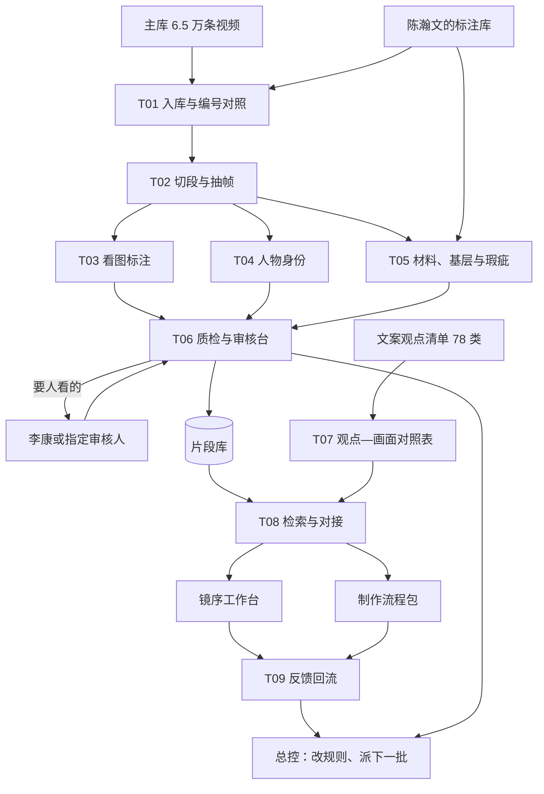

# 素材底座项目总方案 v0.1

2026-11-16，总控（AI）起草，待李康确认。还没有派出任何任务。

## 先说结论

1. **陈瀚文的制作流程包和张艺的镜序工作台，缺的是同一样东西：一个能按画面内容查的片段库。** 流程包找素材靠搜文件名再逐个实看；镜序每句字幕都把原片抽帧发给云端现查，按次计费，2 美元的总预算在今天查询时只剩约 0.07 美元。两边都没有“这一段是什么画面”的现成标签。
2. **这个项目就做这个片段库，再加一张“文案观点 → 画面条件”的对照表。** 配音、字幕、成片、交付这些环节两位同事已经做好了，不重做。
3. **分成 9 个工位交给专门的智能体**，我做总控：定规则、派单、验收、收问题。任务书已经写好。
4. **有 8 件事要你定**（第八节）。其中最要紧的是：由你通知陈瀚文和张艺来对接；看图用云端还是本机模型；谁来做人工审核。

## 一、现在手上有什么

| 谁做的 | 是什么 | 已经做到哪 | 还缺什么 |
|---|---|---|---|
| 陈瀚文 | 标注库 | 46,612 条原片有材料、工序、时段、机器描述 | 机器描述是自由句子，查不出东西；没有画面类型 |
| 陈瀚文 | 制作流程包 5.0（文案→配音→选镜→字幕→质检→交付） | 流程、脚本、检查规则齐全 | 素材索引只有文件名，选镜靠智能体逐个实看 |
| 张艺 | 镜序工作台（素材精裁、分镜板、AI 候选、单条成片） | 登记了 43,137 个文件；有 253 次检索、127 条评价、54 条经验 | 每句都现查原片，慢且按次花钱；预算快用完 |
| 文案这边 | 文案观点清单（Excel） | 232 篇文案拆成 2,043 条观点、78 个素材类别，每类写了适合的画面和限制 | 都是给人读的句子，机器查不了 |
| 这个对话 | 标注总纲 v0.2、专有词表、人物身份确认办法 | 画面类型试标 50 段，你审完对 47 段；阿明的人脸比对验证过 | 只是规则和小样，没有成规模的数据 |

## 二、要搭的框架

分四层看：

- **素材层**（T01–T06）：每一小段素材带上固定选项的标签，进片段库。规则是《素材标注总纲》。
- **翻译层**（T07）：把文案的 78 个素材类别翻成片段库能查的条件。
- **使用层**（T08）：给一句话，查出候选，交给镜序和流程包。采用仍由人决定。
- **回流层**（T09）：人最后选了什么、换了什么，收回来改规则。

## 三、工位和分工

| 任务号 | 工位 | 做什么 | 用看图模型吗 | 什么时候能开工 |
|---|---|---|---|---|
| T01 | 入库与编号对照 | 每个视频一条身份记录；对上标注库、镜序、流程包三套编号；填来源和限制 | 不用 | 现在 |
| T02 | 切段与抽帧 | 把原片切成片段，每段出一张抽帧拼图 | 不用 | T01 之后 |
| T03 | 看图标注 | 画面类型、阶段、人数、朝向、主动作、视角、转场镜头 | 用 | T02 之后 |
| T04 | 人物身份 | 按秒段记出镜的是谁；只有阿明能用程序比对 | 不用大模型，用本机人脸程序 | T03 之后 |
| T05 | 材料、基层与瑕疵 | 材料沿用标注库；看图判基层、水印、别家包装 | 用 | T02 之后 |
| T06 | 质检与审核台 | 合并结果、自动查矛盾、出审核页、出每批准确率报表 | 互检时用 | 每批都要 |
| T07 | 观点—画面对照表 | 78 类逐类翻成查询条件；列出现有标签表达不了的缺口 | 不用 | 现在 |
| T08 | 检索与对接 | 查询脚本；给镜序和流程包的数据格式和对接说明 | 不用 | 第一批入库后 |
| T09 | 反馈回流 | 收回采用和评价记录，出周报和规则修改建议 | 不用 | T08 有人用之后 |
| 总控 | 我 | 定规则版本、派单、验收、收问题单、攒清单问你 | | |

任务书在 `任务书\`，每份写了目的、输入、步骤、每步的完成标准、验收标准、什么情况要停下上报。所有工位共用一份 `共同约定.md`。

## 四、人的角色

| 谁 | 负责什么 |
|---|---|
| 李康 | 拍板第八节的事；每批抽审；裁定疑难 |
| 陈瀚文 | 标注库和流程包的主人；确认片段记录格式；提供本机模型的对比结果；提供流程包的历史记录副本 |
| 张艺 | 镜序的主人；确认给镜序的数据格式；在镜序里接入片段库的候选；导出评价和经验记录 |
| 审核人（待定） | 分担每批的人工审核 |

我联系不到陈瀚文和张艺，对接要由你通知。

## 五、分几步走

每一步有过关条件，过了才进下一步。日期我现在不给：试标只有 50 段，推不出几万段的速度，第一批跑完按实测排。

**第 0 步：定版**

- 你答复第八节的事和试标遗留的 6 个问题。
- T02 重抽金标 50 段，T03 用 v0.2 重标。过关条件：和你审定的画面类型一致的不少于 47 段。
- 和陈瀚文、张艺对完片段记录格式。
- T01、T07 这一步就可以同时开工，它们不用云端模型，也不往共享盘写东西。

**第 1 步：第一批 2,000 段**

- 范围：只取小区库，避开限制目录和嘉贝乐。批刮、成品空间、人物对镜头、人物在现场、握手沟通这五类优先（占爆款镜头的 56%）；试标没抽到的 8 类每类补至少 30 段。
- 同时补完人物：“混有别人”的 5 个文件夹里还没跑的 1,123 条。
- 人工审核上限 500 段。
- 过关条件：按总纲第七节，准确率九成以上的类才放量；七成五到九成的改定义重跑；低于七成五的停标。
- T08 用 3 条真实文案跑出候选，在镜序里试一条片子。

**第 2 步：小区库全量**（39,756 个时段），再扩到 `拍摄\其他`、测试、阿明。

**第 3 步：扒扒库**（22,622 条）。放最后，因为水印多、文件夹名和内容大多对不上。

**一直做的**：每批审核出报表，每周一份回流周报，规则每次改动记进总纲的改动记录。

## 六、问题怎么反馈

1. 工位碰到规则矛盾、选项套不上、要越权才能继续的情况，写一份问题单放进 `问题反馈\`，然后继续做不受影响的部分。
2. 我每批收一次：我能定的直接改规则并记改动记录；要你定的攒成一张清单集中问你。
3. 规则只由我改，改完先在金标集上重跑，每一类都不能比改之前差。
4. 每批结束我给你一页：做了多少、每类准确率、新增了哪些问题、要你定什么。

## 七、和陈瀚文、张艺要对的事

这些是我读他们的东西时发现的口径差别，都不大，但不对齐的话数据接不上：

1. **编号。** 三套系统各有各的编号（标注库 ID、镜序素材 ID、流程包的逻辑路径）。T01 做对照表，格式要两位确认。
2. **阿明的身份。** 镜序的规则写明“禁止靠脸或衣服推断”，只认人工确认的具体时间段。你已同意用本机人脸程序。片段库会把来源写清楚，由镜序决定收不收“程序判定”这一级。
3. **金刚泥。** 观点清单要求“微陶泥、金刚泥、液态陶泥、瓷釉分别核对”；你已确认金刚泥就是微陶泥的另一种叫法。按你的口径走，但要告诉做清单的人。
4. **滚涂和刷涂。** 镜序规则里刷子不算滚涂；我们在主动作里分开了，画面类型里合在一起。给镜序的数据按主动作给。
5. **镜序登记了 43,137 个文件，主库有 65,530 个视频。** 差的是哪些目录，T01 会查清。
6. **指定和禁用素材。** 观点清单写了防水演示优先用哪个文件夹、耐磨演示可用 00428、00429、00430、00434 禁用；流程包里也有你禁用的镜头。这些要并进词表的限制表，统一一份。

## 八、需要你定的事

1. **这个框架和 9 个工位的分法，同意吗？**
2. **由你通知陈瀚文、张艺来对接。** 需要他们各做的事写在第四节。
3. **看图用哪个模型。** 我的建议：第一批用云端（和试标同一种，画面类型对了 47/50），同时请陈瀚文用他电脑上的本机模型按 v0.2 跑金标 50 段，两边比完再定全量。镜序现在也是把抽帧发给云端的。
4. **谁做人工审核。** 第一批上限 500 段，是这次试标的 10 倍。你一个人审，还是指定一位同事分担？
5. **片段库放哪。** 我的建议：先放在本机这个项目文件夹里，不往共享盘写；等格式稳定了再和陈瀚文商量要不要并进他的标注库。
6. **“部位”（墙面、地面、台面、洁具、门窗这些）提前到第一批就标。** 原来排在后面。但观点清单里台面水槽、门窗阳台、卫浴洁具、踢脚线这些类都要按部位找镜头，不标就查不出来。
7. **试标遗留的 6 个问题**，列在 `..\素材标注总纲-20261116\试标50段\v0.2改动说明.md` 第七节，加上 `sheet_13.jpg` 第 1、3、4 格那个问题。
8. **要不要现在就派 T01 和 T07。** 这两个不传图到云端、不往共享盘写、不花检索预算，我可以在这个对话里直接派子智能体去做。

费用我现在给不出可靠数字：试标是用对话里的子智能体跑的，没有按量计费的记录。第一批的量是固定的（2,000 段），跑完我报实际消耗，再决定后面怎么排。

## 九、风险和不做的事

**风险**

- **47/50 是小样本。** 审核时模型的答案就摆在图旁边，实际准确率可能更低；24 类里有 8 类没测过；扒扒库没测过。第一批的审核页会改成先让人自己判、再看模型答案。
- **空间和阶段靠 4 帧判不准。** 试标里空间有 42% 填了“看不清”。v0.2 改成空间从文件夹名带出，还没验证。
- **只有阿明能用程序认。** 其他出镜人没有参照，只能靠文件夹名和人工确认。程序只能确认“是”，不能排除“不是”。
- **两个系统能不能接进来，取决于两位同事。** 我没有改他们程序的权限，也不该改。

**不做的事**

- 配音、字幕、封面、成片、交付：流程包和镜序已经在做。
- 价格、工期、政策、案例数量、质保这些要事实依据的观点（292 条）：画面证明不了，片段库只能给示意镜头，依据要另外核。
- 发布到平台、删除或移动任何现有素材。

## 十、文件在哪

项目文件夹：`D:\codex-work\codex-company\video-harness-lab\references\素材底座项目-20261116\`

- `总方案.md`：这份
- `共同约定.md`：所有工位的共同前提（路径、边界、回报格式、何时上报）
- `片段记录格式-草案.md`：一条片段记录有哪些字段、谁填、和两个系统怎么对上
- `任务书\T01` 到 `T09`：9 份任务书
- `问题反馈\_模板.md`：问题单模板
- `参考资料\文案观点与素材适配清单.xlsx`：你给的 Excel 的副本

规则文件夹：`..\素材标注总纲-20261116\`（总纲 v0.2、专有词表、人物身份确认办法、试标 50 段的全部材料、脚本）

`PROJECT_STATE.md` 我没有动。这个项目要不要记进去，等你说。
