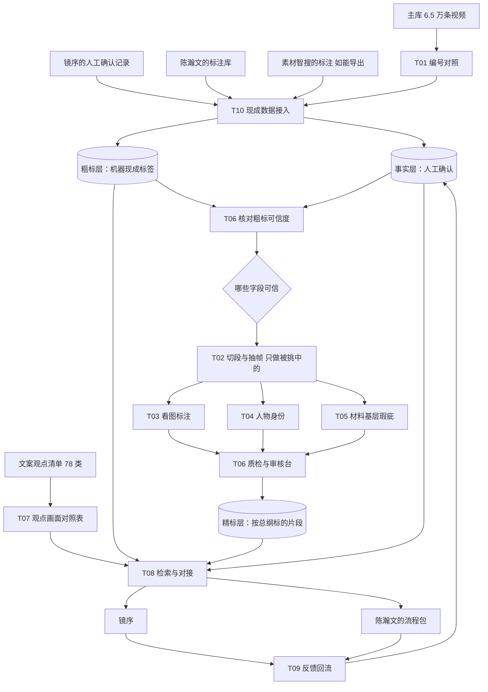

# 素材底座项目总方案 v0.2

2026-11-16，总控（AI）起草，待李康确认。还没有派出任何任务。v0.1 原样保留在 `总方案.md`。

## 先说结论

1. **方向从“从零标注 6.5 万条”改成“先把现成的东西汇到一张表里，贵的看图只用在要紧的地方”。** 今天看了素材智搜和镜序的文件包之后发现：公司里已经有三路现成数据，其中一路是人工逐段确认过的，比我们任何模型标注都可靠。
2. **素材智搜不恢复使用，只借它的数据当粗筛。** 它的标签不能当答案，但可以用来决定“先看哪些素材”。能不能借，取决于张艺能否导出一份数据；借不到也不影响整个方案。
3. **镜序里人工确认过的记录是全项目最值钱的数据，直接并进来当标准答案。** 包括 36 条逐段确认的事实（人物、材料、动作）、127 条“这句话配这个画面合不合适”的评价、6 类动作的正反样例。
4. **工位从 9 个变成 10 个**，新增一个“现成数据接入”。原来 9 个的任务书要按这一版改，改之前不派单。
5. **要你定的事缩成 6 件**（第八节）。

## 一、相对 v0.1 改了什么

| 项目 | v0.1 | v0.2 | 为什么改 |
|---|---|---|---|
| 起点 | 从主库切段、看图、从零标注 | 先汇入三路现成数据，再补缺 | 现成数据比预想的多 |
| 第一批 | 小区库随机取 2,000 段 | 用粗筛结果挑优先类别的段落 | 命中率高，少花看图的钱 |
| 标准答案 | 试标 50 段 | 试标 50 段 + 镜序的人工确认记录 | 镜序有 36 条逐段事实和 26 条动作样例 |
| 阿明身份 | 你确认的文件夹 + 人脸程序 | 加上镜序的逐段事实和 2,098 条来源规则，分级记录 | 多一路人工确认的来源 |
| 编号对照 | 要张艺提供镜序编号 | 镜序编号能从文件路径直接算出来 | 包里看到了算法 |
| 给镜序的对接 | 给候选片段 | 先给“先看哪些素材”的排序 | 镜序现在这一步只靠目录名，改动最小、最省它的预算 |
| 素材智搜 | 没算进来 | 只当粗筛数据源 | 你说明它已弃用 |

## 二、现在手上有什么

| 来源 | 是什么 | 规模 | 可信程度 | 怎么用 |
|---|---|---|---|---|
| 镜序的人工确认记录 | 逐段确认的阿明、微陶泥、动作事实 | 36 条事实；26 条动作样例；9 段人物 | 最高，人工逐段确认并写了依据 | 当标准答案，只对确认的那几秒有效 |
| 镜序的评价和采用记录 | 某句文案配某段画面合不合适 | 127 条评价、240 条采用事件、253 次检索 | 高，是真人的判断 | 给对照表当例子；回流的格式照它来 |
| 你确认的出镜文件夹 | 37 张确认图和排除项 | 37 个文件夹 | 高，文件夹级 | 人物身份的文件夹级来源 |
| 试标 50 段 | 你审过的画面类型等 10 个字段 | 50 段 | 高 | 标准答案 |
| 镜序的阿明来源规则 | “人物出镜类目录里主要讲解者是阿明” | 2,098 条 | 中，写明“未逐片核实” | 只当线索，已有反例 |
| 陈瀚文的标注库 | 材料、工序、时段、机器描述 | 46,612 条原片 | 中，机器标注 | 材料沿用，描述当粗筛 |
| 素材智搜的标注 | 机器描述、标签、每 6 秒一个时间点的字段 | 已上传 29,069 个 | 低，未验证，已发现对不上的例子 | 只当粗筛，先验证再用 |
| 文案观点清单 | 2,043 条观点、78 个素材类别 | — | 高，人写的 | 翻成查询条件 |
| 主素材库 | 共享盘上的原片 | 65,530 个视频 | — | 一切的底 |

镜序的文件包一共 5 卷约 7 GB，我只读得到第 1 卷。第 1 卷里已经有程序、说明、规则和上面这些记录。后 4 卷的内容没看到。

## 三、框架

三层数据放在同一张片段表里，每条记录都写明来自哪一层：

- **事实层**：人工确认过的。只对确认的那个文件、那几秒、那个人有效，不往整个文件夹推广。
- **粗标层**：现成的机器标签。不花钱，覆盖面广，但只用来缩小范围，不用来下结论。
- **精标层**：按《素材标注总纲》看图标出来的。花钱、慢，只做被粗筛挑中或优先类别的段落。

查一句话的过程：先用对照表把这句话翻成条件，用粗标层把几万条缩到几百条，再用事实层和精标层核对，给出候选，人来决定用不用，决定的结果回到事实层。

## 四、素材智搜怎么用

你说它已经弃用，原因是产品的设计逻辑不对。我今天看到的情况支持这个判断：它固定每 6 秒取一张图来描述，标签是机器随手写的词，人物和用途都是机器猜的。所以**不恢复它的流程，只借它已经跑出来的数据**。

**可以借的**

- 空间、部位、原基层、景别、有没有人出镜这类“看得见”的标签，用来粗筛。
- 每 6 秒一条的画面描述，用来搜关键词。
- 它已经把哪些素材归到哪个工程的核实结果（5,412 条）。

**不借的**

- “阿明”标签（3,900 个）：来源不明，镜序和我们的规则都不认机器猜的身份。
- “微陶泥”标签（4,222 个）：镜序的规则是材料外观、颜色、目录名都不能当身份依据。
- 用途打分、可配文案、文案主题：是套话。
- 它的成片、配音、分镜功能：和流程包、镜序重复。

**用之前要过的三关**

1. 张艺能导出一份标注数据。导不出来就到此为止。
2. 能和主库的文件对上号。它是按文件名登记的，要靠文件名加大小、时长来对。
3. 拿标准答案核对，每个字段算一次准确率。准的字段留，不准的字段丢。

三关任何一关过不了，就放弃这一路，方案其余部分不受影响。

## 五、镜序包里能直接用的东西

- **动作的定义**：批刮是工具接触基面铺展或刮平；取料是从桶或托板取料；滚涂必须看到滚筒接触表面滚动，刷子刷不算；滚筒蘸料单独记；擦工具不算取料；样板不能当墙地面。这些并进总纲的主动作定义。
- **身份只认逐段确认**：阿明和微陶泥都只认“某个文件的某几秒”，不套整个目录。我们的规则和它一致。
- **三种经验**：事实（只对那一段有效）、团队标准（对所有新素材有效，要审核）、个人偏好（只影响排序）。回流的格式照这个来。
- **盲测的办法**：看过、评过、调试过的目录不能进盲测。我们后面验收也照这个办。
- **编号算法**：镜序的素材编号是“库别名加相对路径”算出来的，拍摄小区库别名 `xiaoq`，扒扒库别名 `baba`。有了路径就能算，不用找张艺要对照表。
- **一条人物禁用记录**：`汉阳月印府(6.7全屋)\美女人设` 里的一位出镜人，记录写的是已离职、禁止使用其出镜素材。镜序自己写明这条还没接进正式拦截。

## 六、工位

| 任务号 | 工位 | v0.2 做什么 | 相对 v0.1 |
|---|---|---|---|
| T01 | 编号对照 | 主库路径、镜序编号、标注库编号三套对齐；素材智搜的等导出后再对 | 镜序编号改成自己算 |
| T10 | 现成数据接入 | 把镜序的确认记录、标注库、素材智搜导出转成统一的片段记录，分别进事实层和粗标层 | 新增 |
| T06 | 质检与审核台 | 先做一件新事：用标准答案核对粗标层，出每个字段的可信度表。原来的合并、查矛盾、出审核页不变 | 加一项 |
| T02 | 切段与抽帧 | 只切被挑中的素材 | 范围缩小 |
| T03 | 看图标注 | 规则不变。标准答案加上镜序的动作样例 | 标准答案变多 |
| T04 | 人物身份 | 来源分五级：镜序逐段事实、你逐段确认、你文件夹级确认、镜序来源规则、人脸程序。加一张禁用表 | 来源变多 |
| T05 | 材料基层瑕疵 | 材料沿用标注库；部位和原基层先看粗标层，可信就沿用 | 少看图 |
| T07 | 观点画面对照表 | 78 类翻成查询条件。用镜序的 127 条评价当例子 | 多了例子 |
| T08 | 检索与对接 | 两段式检索。给镜序的第一步是“先看哪些素材”的排序 | 对接方式变了 |
| T09 | 反馈回流 | 格式照镜序的事实、团队标准、个人偏好三种 | 格式定了 |

T01、T10、T07 三个不用看图模型、不传图到云端、不往共享盘写，可以最先开工。

## 七、分几步走

**第 0 步：汇入和核对**

- T01 做编号对照，T10 把镜序的确认记录和标注库转成统一格式。
- 如果素材智搜能导出：T10 接入，T06 出字段可信度表。
- T07 做对照表。
- 过关条件：事实层的每条记录都能在主库找到对应文件；可信度表出来；对照表覆盖 78 类。

**第 1 步：第一批精标**

- 用粗标层挑出优先类别的段落，数量按第 0 步的结果定，上限仍是 2,000 段，人工审核上限仍是 500 段。
- 开工前用 v0.2 规则重跑标准答案，画面类型一致的不少于 47 段。
- 过关条件不变：准确率九成以上的类才放量。

**第 2 步：接进镜序试用**

- T08 用 3 条真实文案出“先看哪些素材”的排序，交给张艺在镜序里试。
- 看的是：同样的预算下，镜序找到合格候选的数量有没有变多。

**第 3 步以后**：小区库全量，再到扒扒库。和 v0.1 一样。

## 八、需要你定的事

1. **这一版的方向同意吗？** 也就是先汇现成数据、素材智搜只当粗筛、镜序的确认记录当标准答案。
2. **请张艺做两件事。** 一是导出一份素材智搜的标注数据，一次就够；二是说明镜序确认记录里的“当前用户”是谁，这关系到这些事实是谁确认的。
3. **三个口径要你说一句。**
   - 水洗石：镜序里记的是“水洗石和我们现在的视频无关”，你之前说水洗石素材可以复用。我的理解是水洗石素材只用在讲水洗石的片子里，对吗？
   - `美女人设` 那位出镜人：镜序记的是离职禁用。这是不是词表里的“美女姐姐”？禁用是否成立？
   - 镜序有一条反例：`二印小区厨卫\人物出镜` 里有一段主要人物不是阿明。所以“人物出镜目录里的讲解者都是阿明”这条来源规则只当线索用，不当确认，可以吗？
4. **看图用哪个模型**，和 v0.1 一样：建议第一批用云端，请陈瀚文用本机模型跑一遍标准答案对比。
5. **谁做人工审核**，和 v0.1 一样。
6. **要不要现在派 T01、T10、T07。** 派之前我会先把这三份任务书按这一版改好给你看。

v0.1 里“片段库放哪”“部位提前标”两条我按原建议走：片段库先放本机项目文件夹；部位先看粗标层够不够用。试标遗留的几个问题仍然有效，列在 `..\素材标注总纲-20261116\试标50段\v0.2改动说明.md` 第七节。

## 九、还不知道的

- 素材智搜的标注准不准，没核对过。
- 素材智搜的数据能不能导出、有没有记原始路径。
- 镜序包后 4 卷里是什么。本机没有能解分卷包的程序，第 1 卷之外的我读不到。
- 镜序在线上的登记表（43,137 个文件）不在我读到的部分里。
- 本机看图模型的效果，没跑过。
- 费用：仍然给不出可靠数字，第一批跑完报实际消耗。

## 十、风险和不做的事

**风险**

- **粗标层可能整体不可用。** 如果核对下来没有一个字段过关，第一批就退回 v0.1 的做法，按目录名挑段落。
- **事实层很小。** 36 条事实、50 段试标，覆盖不了多少类别。它的用处是当尺子，不是当库。
- **三套工具由两位同事各自维护。** 我不改他们的程序，对接要他们愿意接。
- v0.1 列的风险仍然成立：试标是小样本、空间和阶段靠几帧判不准、只有阿明能用程序认。

**不做的事**

- 不恢复素材智搜的使用，不在它上面开发。
- 不触发镜序的付费检索，不用它页面上的口令。
- 配音、字幕、封面、成片、交付不做。
- 不删除、不移动、不改名任何现有素材，不往共享盘写。

## 十一、文件在哪

项目文件夹：`D:\codex-work\codex-company\video-harness-lab\references\素材底座项目-20261116\`

- `总方案_v0.2.md`：这份
- `总方案.md`：v0.1，保留
- `共同约定.md`、`片段记录格式-草案.md`、`任务书\T01` 到 `T09`：还是 v0.1 的内容，等你同意这一版后再改，并新增 T10
- `参考资料\镜序包摘录-20261116\`：从镜序包第 1 卷摘出来的程序、说明、规则和确认记录，804 个文件约 76 MB，只读参考
- `参考资料\文案观点与素材适配清单.xlsx`：Excel 副本

`PROJECT_STATE.md` 我没有动。

## 十二、改动记录

| 版本 | 日期 | 改了什么 |
|---|---|---|
| v0.1 | 2026-11-16 | 第一版：9 个工位，从零建片段库 |
| v0.2 | 2026-11-16 | 看过素材智搜和镜序包后改：三层数据、新增 T10、素材智搜只当粗筛、镜序确认记录当标准答案、对接镜序改成先给排序 |
