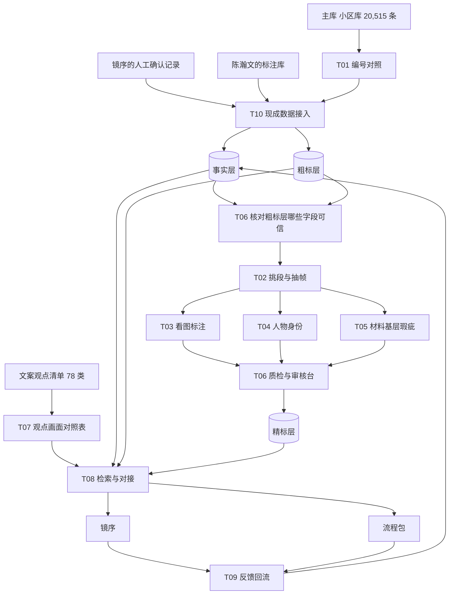

# 素材底座项目总方案 v0.3

2026-11-16，总控（AI）起草，待李康确认。还没有派出任何任务。v0.1 在 `总方案.md`，v0.2 在 `总方案_v0.2.md`，都原样保留。这一份可以单独读，不用翻前两版。

## 先说结论

1. **三个人在给同一批素材做同一件事，这个项目把它收成一处。** 陈瀚文的标注库、张艺的镜序、我们的标注总纲，对着的都是小区库和扒扒库这 4.3 万条视频。张艺的任务台账里，“模型预标注加人工审核”和“全库整理”两步都排着还没开始，前面的小样本试点卡住了。建议标注只在这个项目里做一遍，镜序和流程包直接用结果。
2. **素材智搜不再考虑。** 方案里所有和它有关的内容都删了。
3. **第一步不花看图的钱。** 先把三套编号对齐，把镜序里人工确认过的记录和陈瀚文标注库的现成标签汇进一张表，把文案的 78 个素材类别翻成查询条件。这三件事不用看图模型，不传图到云端，不往共享盘写。
4. **范围先只做小区库**（20,515 条）。它是两位同事的系统都登记了的、自己拍的素材。扒扒库和其余 2.2 万条放后面。
5. **成不成用镜序现在的数字来比。** 镜序的记录里，展示过 1,419 个素材，采用 60 个；评过的 126 条候选里，合适的 14 条。片段库接进去之后，这两个比例要明显变好才算数。
6. **要你定 7 件事**（第七节）。最要紧的是第 1 件：和张艺、陈瀚文说清楚标注由谁来做。

## 一、现在手上有什么

完整的镜序包已经解到 `D:\CutFrame项目完整整理_20261116\`，我全部看过了（密钥文件除外）。盘点结果单独写在 `参考资料\镜序包盘点-20261116.md`。

### 素材

主库 `\\192.168.110.36\共享本公司\史上最完整共享` 共 65,530 个视频。

| 部分 | 条数 | 镜序登记了吗 | 陈瀚文标注库有吗 |
|---|---|---|---|
| `拍摄\小区` | 20,515 | 有 | 有 |
| `扒扒` | 22,622 | 有 | 有 |
| `拍摄\测试`、`拍摄\阿明`、`拍摄\搅拌` | 637 | 没有 | 有 |
| `拍摄\客户的素材(人物需打码)` | 8,463 | 没有 | 没有 |
| `拍摄\展厅` | 5,719 | 没有 | 没有 |
| `拍摄\其他` | 4,590 | 没有 | 没有 |
| `拍摄\招商` | 2,102 | 没有 | 没有 |
| `其他`、`文案` | 882 | 没有 | 没有 |

镜序的登记表和我们的主库清单逐条对过，小区和扒扒两库路径、大小都一致，只差 1 个文件。镜序的素材编号可以从文件路径直接算出来，不用找张艺要对照表。

### 现成的数据

| 来源 | 是什么 | 规模 | 可信程度 |
|---|---|---|---|
| 镜序的逐段事实 | 某个文件某几秒是阿明、是微陶泥、是什么动作 | 36 条 | 最高。人逐段确认，只对那几秒有效 |
| 镜序的确认样例 | 动作、产品、人物的正反例 | 动作 26 条、产品 24 条、人物 9 段 | 最高 |
| 镜序的评价和采用 | 这句文案配这段画面合不合适；最后用了哪段 | 评价 127 条、采用事件 240 条 | 高。真人判断 |
| 试标 50 段 | 你审过的画面类型等字段 | 50 段 | 高 |
| 你确认的出镜文件夹 | 确认图和排除项 | 37 个文件夹 | 高，文件夹级 |
| 陈瀚文标注库里人工核对的片段 | 带起止秒数的精标片段 | 264 段 | 高，但还没核对过口径是否和总纲一致 |
| 陈瀚文标注库的机器标注 | 每 4 到 12 秒一段的画面描述、施工镜头表、材料 | 小区 39,756 段、扒扒 113,117 段；施工镜头表 21,652 段 | 中。机器写的，没验证过 |
| 镜序的阿明来源规则 | “人物出镜类目录里主要讲解者是阿明” | 2,098 条 | 低。注明未逐片核实，已有反例 |
| 目录名 | 小区库的项目名、子文件夹名 | — | 只当线索。扒扒库的文件名标签大多对不上 |
| 文案观点清单 | 2,043 条观点、78 个素材类别 | — | 高，人写的 |

### 两位同事各自走到哪

**张艺的镜序。** 制作工具基本做出来了：精裁、配音、字幕、配乐、单条成片都有，其中一部分还在等验收。128 项任务里完成 64 项、待验收 20 项。卡在选片上：

- 找素材是每句字幕现把原片抽帧发给云端看，按次花钱。2 美元的预算基本用完。
- “先看哪些原片”这一步只靠目录名和文件名里的词。
- 他自己定的路线是：小样本人工标注，然后本机模型预标注加人工审核，最后全库整理。第一步的 30 个文件用完了上限，全是 AI 看 4 张抽帧写的草稿，没有一条经过人确认，台账写的是“当前不能通过”。后两步没开始。
- 他试过用本机的小模型（Qwen3-VL-4B）找批刮镜头：60 条里判通过 11 条，对 7 条、错 4 条，还漏了 3 条。记录的结论是未通过。

**陈瀚文的流程包和标注库。** 从文案到交付的整条流程齐全。标注库覆盖面最广，但分类只有材料、工序和三种用途，没有“这是什么画面”这个字段；找素材靠搜文件名再逐个实看。

**缺的是同一样东西**：每一小段素材是什么画面、谁在里面、能配哪类文案，写成固定选项，能查。这就是片段库。

## 二、框架

片段库是一张表，每条记录是一段素材（哪个文件、从几秒到几秒），并写明它的标签来自下面哪一层：

- **事实层**：人确认过的。只对确认的那个文件、那几秒、那个人有效，不推广到整个文件夹。
- **粗标层**：陈瀚文标注库里现成的机器标签，加上目录名。不花钱，覆盖面广，只用来缩小范围，不用来下结论。
- **精标层**：按《素材标注总纲》看图标出来的。要花钱，只做被挑中的段落。

查一句文案的过程：对照表把这句话翻成条件；粗标层把两万条缩到几百条；事实层和精标层核对；给出候选；人决定用不用；人的决定回到事实层。

## 三、工位

| 任务号 | 工位 | 做什么 | 用看图模型吗 |
|---|---|---|---|
| T01 | 编号对照 | 小区库每个视频一条记录：主库路径、镜序编号（按路径算）、标注库编号。补上时长、横竖屏。填来源限制和禁用 | 不用 |
| T10 | 现成数据接入 | 镜序的确认记录进事实层；标注库的分段描述、施工镜头表、材料进粗标层。每条记录保留出处 | 不用 |
| T07 | 观点画面对照表 | 78 个素材类别逐类翻成查询条件；用镜序的 127 条评价和那份成片拆解当例子；列出现有标签表达不了的缺口 | 不用 |
| T06 | 质检与审核台 | 先用事实层和试标 50 段核对粗标层，出一张“哪些字段可信”的表。之后每批合并结果、查矛盾、出审核页和准确率报表 | 互检时用 |
| T02 | 挑段与抽帧 | 按可信的粗标挑出第一批段落。标注库每段已经有抽帧拼图，先验证能不能直接用，能用就不重抽 | 不用 |
| T03 | 看图标注 | 画面类型、阶段、人数、朝向、主动作、视角、转场镜头。动作定义并入镜序的口径 | 用 |
| T04 | 人物身份 | 按秒段记出镜人。来源分级：逐段确认、文件夹级确认、来源规则、人脸程序。维护一张禁用表 | 用本机人脸程序 |
| T05 | 材料基层瑕疵 | 材料沿用标注库；部位和基层先看粗标层够不够用，不够再看图 | 视情况 |
| T08 | 检索与对接 | 查询脚本。给镜序的第一样东西是“先看哪些原片”的排序，替掉它现在靠目录名的那一步 | 不用 |
| T09 | 反馈回流 | 定期收镜序和流程包的评价、采用记录，格式照镜序的事实、团队标准、个人偏好三种 | 不用 |

T01、T10、T07 三个现在就能开工。任务书目前还是 v0.1 的内容，方向定了我再改，并新写 T10。

**从镜序并进规则的四条**

- 动作定义：批刮是工具接触基面铺展或刮平材料；取料是从桶或托板取料；滚涂必须看到滚筒接触表面滚动，刷子刷不算；滚筒蘸料单独记；擦工具不算取料；样板不能当墙地面。
- 身份只认逐段确认，材料外观、颜色、目录名都不能当依据。
- 一段里有两个动作的，分开记起止时间，中间过渡不算。
- 看过、评过、调试过的目录不拿来做验收。

## 四、分几步走

每一步有过关条件，过了才进下一步。日期现在不给：试标只有 50 段，推不出两万条的速度，第 1 步跑完按实测排。

**第 0 步：汇入和对照（不花看图的钱）**

- T01、T10、T07 同时做。
- T06 出粗标层的可信度表。
- 过关条件：小区库每条视频三套编号都对上；事实层每条记录都能在主库找到文件；可信度表出来；对照表覆盖 78 类并列出缺口。
- 这一步结束时可以先交一样东西：对可信的那几类（估计是批刮、搅拌这类施工镜头），直接从粗标层给镜序一份“先看哪些原片”的清单。

**第 1 步：第一批精标**

- 范围只在小区库，避开限制目录。按粗标挑段，上限 2,000 段，人工审核上限 500 段。
- 优先五类：批刮、成品空间、人物对镜头、人物在现场、握手沟通。这五类占爆款镜头的 56%。
- 开工前先用现行规则重跑试标 50 段，画面类型一致的不少于 47 段。
- 验收用另外留出的一批，不用调规则时看过的那些。
- 过关条件：准确率九成以上的类才放量；七成五到九成的改定义重跑；低于七成五的停标。

**第 2 步：接进镜序试用**

- 用 3 条真实文案出候选，交给张艺和小山在镜序里试。
- 比的是采用比例和合适比例有没有比现在高。达标线见第七节第 6 件。

**第 3 步：放量**

- 小区库全量，然后 `拍摄\其他`、测试、阿明、搅拌。
- 扒扒库放后面：水印多，文件名标签大多对不上，标注库对它的描述质量也差一些。
- 展厅、招商、客户素材最后看需要再定。

**一直做的**：每批出准确率报表；规则改动记进总纲的改动记录；镜序包是今天的副本，线上还在变，T09 定期请张艺导出新的记录。

## 五、和两位同事怎么接

我联系不到陈瀚文和张艺，对接要由你通知。

| 对谁 | 我们给 | 请他做 |
|---|---|---|
| 张艺 | 第 0 步后：“先看哪些原片”的清单，按镜序编号给。第 1 步后：带起止秒数的候选片段 | 确认数据格式；在镜序里接入；定期导出评价和采用记录；说明确认记录里的“当前用户”是谁 |
| 陈瀚文 | 片段库的查询结果，按流程包的逻辑路径给 | 确认片段记录格式；用他电脑上的本机模型跑一遍试标 50 段做对比；同意我们把标注库的库文件复制一份到本机只读查看 |

**要和张艺对齐的一点：** 他台账里的“方案 B 本机模型预标注”和“方案 C 全库整理”，就是这个项目的第 1 步和第 3 步。两边各做一遍是浪费。我的建议是这两步由本项目做，镜序接结果，他的精力留在制作工具和接入上。这要你来和他说，他同意才算数。

## 六、怎么反馈问题

1. 工位碰到规则矛盾、选项套不上、要越权才能继续的情况，写一份问题单放进 `问题反馈\`，然后继续做不受影响的部分。
2. 我每批收一次：我能定的直接改规则并记改动记录；要你定的攒成一张清单集中问你。
3. 规则只由我改，改完先在试标 50 段上重跑，每一类都不能比改之前差。
4. 每批结束我给你一页：做了多少、每类准确率、新增了哪些问题、要你定什么。

## 七、需要你定的事

1. **方向和分工同意吗？** 标注只在这个项目做一遍，先做小区库，镜序和流程包接结果。同意的话，由你通知张艺和陈瀚文，要他们做的事在第五节。
2. **三个口径要你说一句。**
   - 水洗石：镜序里记的是“水洗石和我们现在的视频无关”，你之前说水洗石素材可以复用。我的理解是水洗石素材只用在讲水洗石的片子里，对吗？
   - `汉阳月印府(6.7全屋)\美女人设` 里的出镜人：镜序记的是已离职、禁止使用其出镜素材，但镜序自己还没把这条接进拦截。这位是不是词表里的“美女姐姐”？禁用成立吗？你答复之前我按禁用处理。
   - 镜序有一条反例：`二印小区厨卫\人物出镜` 里有一段主要人物不是阿明。所以“人物出镜目录里的讲解者是阿明”只当线索，不当确认，可以吗？
3. **看图用哪个模型。** 建议第一批用云端（试标用的那种，画面类型对了 47/50）。张艺用本机小模型找批刮没通过，所以本机模型先只做对比，不直接上。
4. **谁做人工审核。** 第一批上限 500 段。你一个人审，还是加上小山或别的同事？
5. **片段库放哪。** 建议先放本机这个项目文件夹，不往共享盘写；格式稳定后再和两位同事商量。
6. **第 2 步的达标线。** 镜序现在的数字是：展示 1,419 个素材采用 60 个，大约 24 个里用 1 个；评过的 126 条里合适 14 条，大约 9 条里 1 条。我的建议是合适的比例至少翻一倍才算有用。这个数你来定。
7. **要不要现在派 T01、T10、T07。** 派之前我先把这三份任务书改好给你看。

试标遗留的几个问题仍然有效，列在 `..\素材标注总纲-20261116\试标50段\v0.2改动说明.md` 第七节。

## 八、还不知道的

- **标注库的机器标注准不准。** 没核对过，第 0 步的可信度表就是来回答这个的。
- **标注库的抽帧拼图能不能直接用来标画面类型。** 试标用的是我们自己抽的帧。
- **镜序那两个比例能不能直接拿来比。** 它们是历史记录里数出来的，不是同一批文案下的对照。第 2 步前要和张艺定一个公平的比法。
- **镜序预算用完之后张艺怎么试。** 试用可能要他追加预算，或者改成人直接看我们给的候选。
- **本机看图模型的效果。** 只有张艺那一次小模型的试验，陈瀚文的模型没比过。
- **费用。** 仍然给不出可靠数字，第一批跑完报实际消耗。

## 九、风险和不做的事

**风险**

- **粗标层可能不够用。** 如果可信度表里没有一个字段过关，第一批就按目录名挑段，和 v0.1 一样，只是多花些看图的钱。
- **事实层很小。** 36 条事实加 50 段试标，是当尺子用的，覆盖不了多少类别。
- **47/50 是小样本。** 24 类画面里有 8 类没测过，扒扒库没测过。
- **只有阿明能用程序认。** 其他出镜人没有参照，只能靠文件夹名和人工确认。
- **两套工具由两位同事各自维护。** 我不改他们的程序，接不接取决于他们。

**不做的事**

- 素材智搜：不用、不接、不在它上面开发。
- 配音、字幕、封面、成片、交付：流程包和镜序已经在做。
- 价格、工期、政策、案例数量、质保这类要事实依据的观点（292 条）：画面证明不了，片段库只给示意镜头。
- 不触发镜序的付费检索，不用它页面上的口令，不打开它的密钥文件。
- 不删除、不移动、不改名任何现有素材，不往共享盘写。

## 十、文件在哪

项目文件夹：`D:\codex-work\codex-company\video-harness-lab\references\素材底座项目-20261116\`

- `总方案_v0.3.md`：这份
- `总方案_v0.2.md`、`总方案.md`：前两版，保留
- `参考资料\镜序包盘点-20261116.md`：镜序包里有什么、数字从哪来
- `共同约定.md`、`片段记录格式-草案.md`、`任务书\T01` 到 `T09`：还是 v0.1 的内容，方向定了再改，并新增 T10
- `参考资料\文案观点与素材适配清单.xlsx`：Excel 副本
- `参考资料\镜序包摘录-20261116\`：早先从第 1 卷摘的 804 个文件，现在和完整包重复

规则文件夹：`..\素材标注总纲-20261116\`（总纲 v0.2、专有词表、人物身份确认办法、试标 50 段的材料）

镜序完整包：`D:\CutFrame项目完整整理_20261116\`，只读参考

`PROJECT_STATE.md` 我没有动。

## 十一、改动记录

| 版本 | 日期 | 改了什么 |
|---|---|---|
| v0.1 | 2026-11-16 | 第一版：9 个工位，从零建片段库 |
| v0.2 | 2026-11-16 | 看过素材智搜和镜序包第 1 卷后改：三层数据、新增 T10、素材智搜只当粗筛 |
| v0.3 | 2026-11-16 | 删掉素材智搜；看完镜序完整包后补上登记表对照、张艺的路线和进度、镜序的基准数字；范围定为先做小区库；提出标注只做一遍的分工；粗标层改为只用陈瀚文的标注库 |
